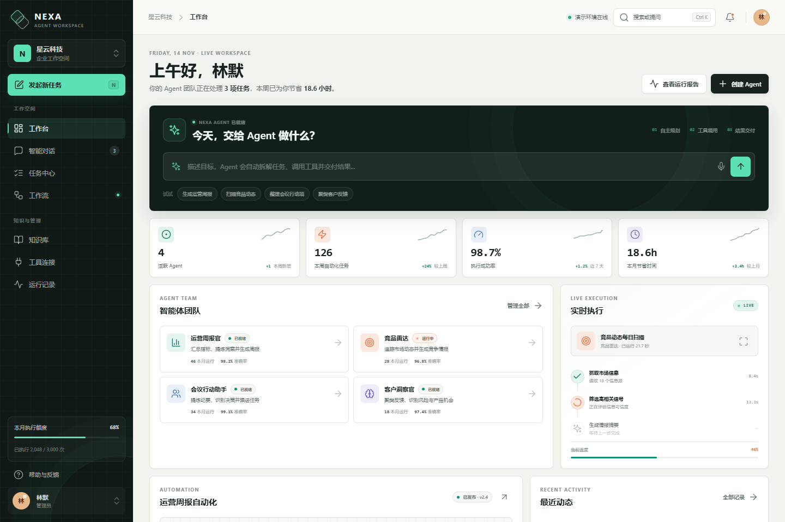
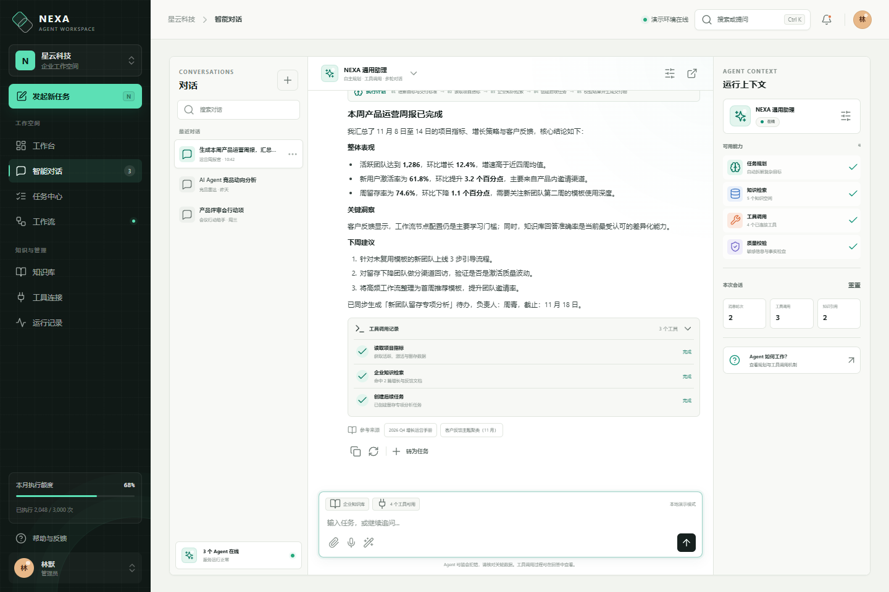
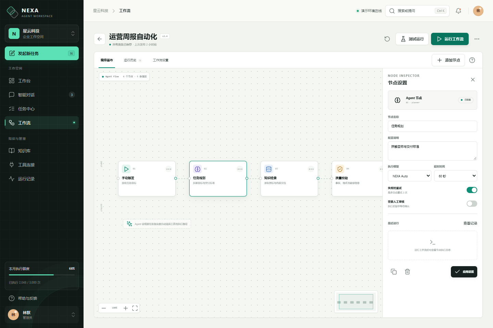
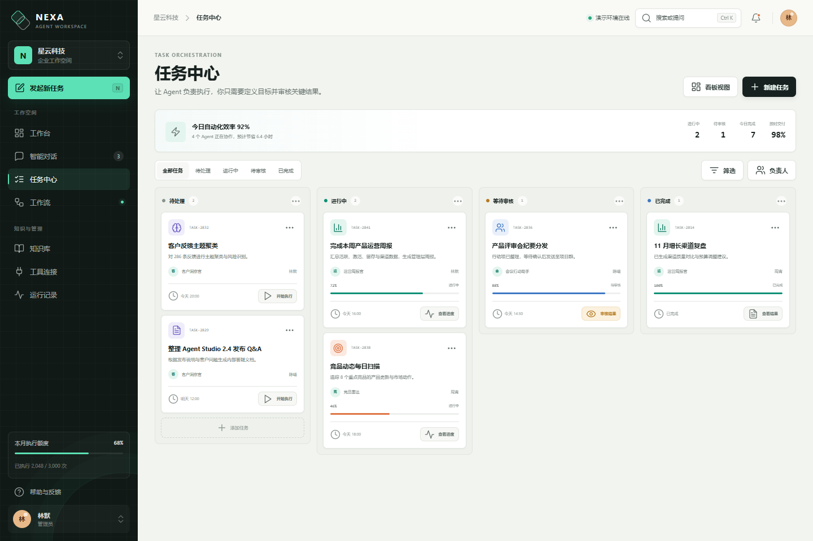
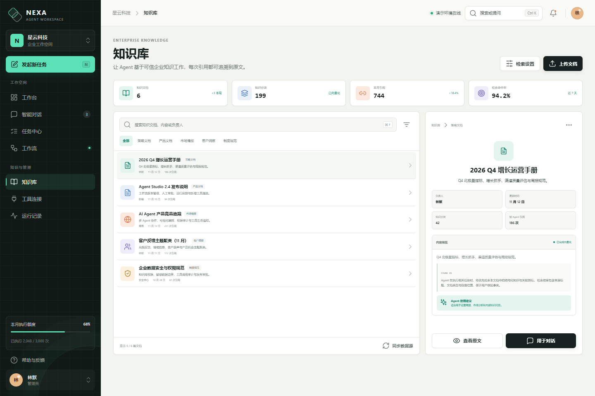
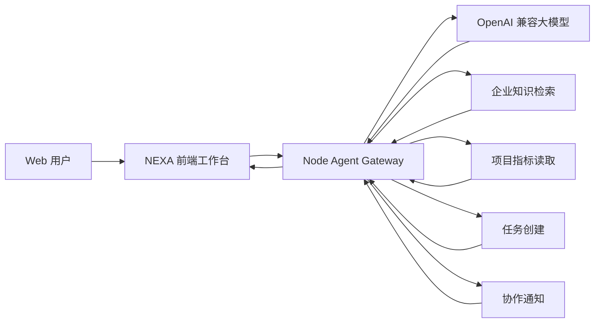

# NEXA Agent Workspace

> 面向传智杯 AI Web 网页开发挑战赛的 AI Agent 智能体应用与自动化工作流平台

## 团队信息

| 项目 | 内容 |
| --- | --- |
| 团队名称 | NEXA Team |
| 参赛院校 | 请在正式提交前填写 |
| 团队成员 | 请在正式提交前填写 |
| 指导教师 | 请在正式提交前填写 |
| 队长联系方式 | 请在正式提交前填写 |
| 项目仓库 | 请在推送 GitHub / Gitee 后填写 |
| 在线演示 | 可选，部署后填写公网地址 |

## 项目简介

NEXA Agent Workspace 是一个可直接运行的 AI Agent Web 应用。用户只需描述目标，Agent 即可完成任务理解、自主规划、企业知识检索、数据读取、工具调用和结果交付；所有执行过程均以可观测轨迹呈现，并支持多轮追问与人工审核。

项目围绕赛题要求的四项核心能力展开：

| 赛题能力 | 项目实现 |
| --- | --- |
| 基于大模型 | 接入任意 OpenAI 兼容 Chat Completions 接口，支持 DeepSeek、OpenAI 等模型 |
| 自主规划 | 展示“理解目标 → 拆解步骤 → 选择工具 → 校验交付”的任务执行计划 |
| 工具调用 | 内置知识检索、项目指标、任务创建、协作通知四类工具，采用模型原生 Tool Calling |
| 多轮对话 | 保存会话上下文，支持连续追问、重新生成、停止执行和任务转化 |
| 自动化工作流 | 提供可视化节点画布、运行动画、节点配置、执行日志和运行回放 |



## 核心功能

- **Agent 工作台**：统一查看 Agent 团队、实时任务、自动化效率与执行动态。
- **智能对话**：任务规划、工具调用轨迹、知识来源引用、多轮上下文与运行状态可见。
- **任务中心**：待处理、进行中、待审核、已完成四阶段看板，支持人工审核闭环。
- **工作流编排**：六节点运营周报流程、节点拖拽、缩放、配置面板、模拟运行与日志。
- **企业知识库**：文档分类、语义检索入口、引用统计、上传解析与文档预览。
- **工具连接**：飞书、企业微信、Notion、GitHub、Webhook、REST API 的授权与启停管理。
- **运行记录**：执行成功率、耗时、Token 用量、完整轨迹与错误恢复入口。
- **全局命令中心**：`Ctrl + K` 搜索页面、调用快捷任务或打开功能。
- **响应式体验**：适配 1440px 桌面、平板和 390px 移动端。

## 界面预览

| 智能对话 | 工作流编排 |
| --- | --- |
|  |  |

| 任务中心 | 知识库 |
| --- | --- |
|  |  |

## 快速启动

环境要求：Node.js 20 或更高版本。

```bash
npm run dev
```

浏览器访问：<http://localhost:4173>

项目没有第三方前端依赖，也不需要构建，首次启动即可使用。未配置模型 Key 时自动进入本地演示模式，所有主要交互仍可完整体验。

项目使用 Node.js 内置模块，无需执行 `npm install`。浏览器验收所需的 Python 工具和 FFmpeg 运行包见 [`requirements-dev.txt`](requirements-dev.txt)；完整环境说明见 [`docs/06-环境配置与依赖清单.md`](docs/06-环境配置与依赖清单.md)。

### 接入真实大模型

复制 `.env.example` 为 `.env`，填写 OpenAI 兼容接口信息：

```dotenv
LLM_BASE_URL=https://api.deepseek.com/v1
LLM_MODEL=deepseek-chat
LLM_API_KEY=your_api_key
PORT=4173
```

重启服务后，右上角状态会显示“LLM 服务在线”。服务端会根据用户目标自动选择工具，并把工具返回结果重新交给模型完成最终回答。

## 系统架构



前端负责工作台、对话、任务、工作流和可观测性体验；服务端负责模型代理、工具注册、工具执行、执行轨迹聚合和演示模式降级。

## 目录结构

```text
.
├─ index.html                  # 应用入口与基础壳
├─ server.mjs                  # 静态服务、模型代理与 Agent 工具循环
├─ assets/
│  ├─ app.js                   # 状态、页面渲染与交互逻辑
│  ├─ icons.js                 # Lucide 风格本地图标系统
│  └─ styles.css               # 完整视觉与响应式样式
├─ screenshots/                # 浏览器验收截图
├─ tests/
│  └─ visual_check.py          # Playwright 视觉与交互冒烟测试
├─ tools/                      # PDF、视频、截图构建脚本
├─ output/
│  ├─ pdf/                     # 技术文档 PDF
│  └─ video/                   # 1080p 演示视频、字幕与配音稿
├─ docs/
│  ├─ 01-项目说明书.md
│  ├─ 02-技术方案.md
│  ├─ 03-演示视频脚本.md
│  ├─ 04-提交清单与能力对照.md
│  ├─ 05-Agent提示词与工具定义.md
│  ├─ 06-环境配置与依赖清单.md
│  ├─ 07-团队信息与仓库发布.md
│  ├─ 08-在线部署指南.md
│  └─ 09-提交前最终检查表.md
├─ Dockerfile
├─ requirements-dev.txt
├─ .env.example
└─ package.json
```

## 验收方式

```bash
npm run check
python tests/visual_check.py
```

`npm run check` 检查服务端与前端 JavaScript 语法。`visual_check.py` 使用本机 Edge 和 Playwright 验证桌面端、移动端、对话生成、工作流运行、任务看板、知识库、工具连接和运行记录，并重新生成 `screenshots/`。

## 工具调用设计

服务端注册的工具：

| 工具 | 用途 | 是否写操作 |
| --- | --- | --- |
| `search_knowledge` | 按关键词检索企业知识并返回来源 | 否 |
| `get_project_metrics` | 读取产品与增长运营指标 | 否 |
| `create_follow_up` | 创建可追踪的后续行动项 | 是 |
| `send_notification` | 向飞书、企业微信或邮箱发送摘要 | 是 |

模型最多执行四轮工具调用，避免不可控循环。工具失败会作为结构化结果回传模型，由模型解释影响并给出替代路径。

## 安全与可观测性

- 模型 Key 只保存在服务端环境变量中，不进入浏览器。
- 写操作工具只在用户明确要求推进或发送时调用。
- 每次工具调用都记录工具名称、参数结果摘要、完成状态和来源。
- 工作流、运行记录与人工审核节点共同构成可追溯闭环。
- 演示模式不访问外部网络，便于比赛现场稳定展示。

## 提交材料

### 技术文档

- [PDF 技术文档](output/pdf/NEXA-Agent-Workspace-技术文档.pdf)，A4，15 页，包含项目概述、需求分析、系统架构、AI 技术方案、功能实现、测试部署、创新点与展望。
- [技术文档构建脚本](tools/build_technical_pdf.py)

### 演示视频

- [1080p 演示视频（字幕版）](output/video/NEXA-Agent-Workspace-演示视频-字幕版.mp4)，7 分 20 秒。
- [中文字幕 SRT](output/video/NEXA-Agent-Workspace-演示字幕.srt)
- [普通话配音稿](output/video/NEXA-Agent-Workspace-配音稿.txt)

当前视频包含完整画面和烧录字幕，音轨为静音；正式提交前请按配音稿录制普通话旁白并替换音轨。详细录制说明见 [`docs/03-演示视频脚本.md`](docs/03-演示视频脚本.md)。

### 文档与清单

详细材料位于 [`docs/`](docs/)：

- [项目说明书](docs/01-项目说明书.md)
- [技术方案](docs/02-技术方案.md)
- [演示视频脚本](docs/03-演示视频脚本.md)
- [提交清单与能力对照](docs/04-提交清单与能力对照.md)
- [Agent 提示词与工具定义](docs/05-Agent提示词与工具定义.md)
- [环境配置与依赖清单](docs/06-环境配置与依赖清单.md)
- [团队信息与仓库发布](docs/07-团队信息与仓库发布.md)
- [在线部署指南](docs/08-在线部署指南.md)
- [提交前最终检查表](docs/09-提交前最终检查表.md)

## Git 与仓库发布

```bash
git remote add origin <GitHub 或 Gitee 仓库地址>
git push -u origin main
```

推送前确认：

- `.env` 未进入 Git。
- 仓库可见性为 Public，或已配置评审访问权限。
- README 中团队信息和仓库地址已填写。
- 运行 `npm run check` 和 `python tests/visual_check.py`。

## License

本项目用于传智杯 AI Web 网页开发挑战赛参赛与评审展示。第三方名称和图标仅用于产品功能示意。
