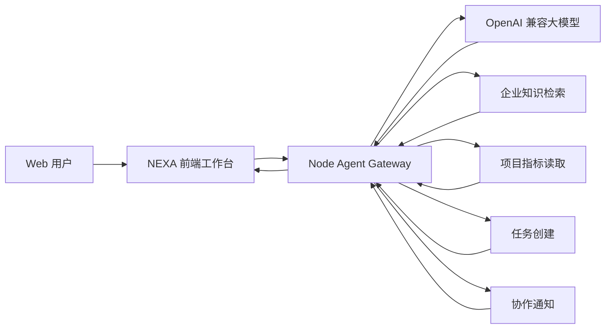

# NEXA Agent Workspace

> 面向传智杯 AI Web 网页开发挑战赛的 AI Agent 智能体应用与自动化工作流平台

## 团队信息

| 项目 | 内容 |
| --- | --- |
| 团队名称 | NEXA Team |
| 参赛院校 | 枣庄学院 |
| 团队成员 | 张贵泰、马勇、从荣达 |
| 项目仓库 | <https://github.com/zhangguitai/nexa-agent> |
| 技术形态 | 原生 Web 前端 + Node.js Agent Gateway |
| 项目状态 | 可本地运行、可 Docker 部署、支持真实模型与本地演示双模式 |

## 项目简介

NEXA Agent Workspace 是一个可直接运行的 AI Agent Web 应用。用户只需描述目标，Agent 即可完成任务理解、自主规划、企业知识检索、数据读取、工具调用和结果交付；所有执行过程均以可观测轨迹呈现，并支持多轮追问、停止执行与人工审核。

项目并非静态展示页。配置模型 Key 后，Node.js 服务端会调用 OpenAI 兼容的 Chat Completions 接口，根据模型返回的 `tool_calls` 执行白名单工具，再把结构化结果写回上下文；未配置 Key 或模型异常时，系统自动切换到结构一致的本地演示模式，保证评审现场稳定运行。

## 赛题能力

| 赛题能力 | 项目实现 |
| --- | --- |
| 基于大模型 | 接入任意 OpenAI 兼容 Chat Completions 接口，支持 DeepSeek、OpenAI 等模型 |
| 自主规划 | 展示“理解目标 → 拆解步骤 → 选择工具 → 校验交付”的任务执行计划 |
| 工具调用 | 内置知识检索、项目指标、任务创建、协作通知四类工具，采用模型原生 Tool Calling |
| 多轮对话 | 保留活动会话上下文，支持连续追问、重新生成、停止执行和任务转化 |
| 自动化工作流 | 提供可视化节点画布、运行动画、节点配置、执行日志和运行回放 |
| 可观测与人工审核 | 展示计划、工具轨迹、来源、状态、耗时和待审核任务 |


## 核心功能

- **Agent 工作台**：统一查看 Agent 团队、实时任务、自动化效率与执行动态。
- **智能对话**：任务规划、工具调用轨迹、知识来源引用、多轮上下文与运行状态可见。
- **任务中心**：待处理、进行中、待审核、已完成四阶段看板，支持人工审核闭环。
- **工作流编排**：六节点运营周报流程、节点拖拽、缩放、配置面板、模拟运行与日志。
- **企业知识库**：文档分类、语义检索入口、引用统计、上传解析与文档预览。
- **工具连接**：飞书、企业微信、Notion、GitHub、Webhook、REST API 的授权与启停管理。
- **运行记录**：执行成功率、耗时、Token 用量、完整轨迹与错误恢复入口。
- **全局命令中心**：`Ctrl + K` 搜索页面、调用快捷任务或打开功能。
- **响应式体验**：适配 1440px 桌面、平板和 390px 移动端。

## 快速启动

### 环境要求

- Node.js 20 或更高版本。
- npm 随 Node.js 安装，不要求执行 `npm install`。
- Windows、Linux 或 macOS。
- 真实模型模式需要访问所配置的模型接口；本地演示模式无需外网。

### 本地运行

```bash
npm run dev
```

浏览器访问 <http://localhost:4173>。未配置模型 Key 时自动进入本地演示模式，主要交互仍可完整体验。

健康检查：

```bash
curl http://localhost:4173/api/health
```

### 接入真实大模型

复制环境变量模板：

```powershell
# Windows PowerShell
Copy-Item .env.example .env
```

```bash
# Linux / macOS
cp .env.example .env
```

填写 OpenAI 兼容接口：

```dotenv
LLM_BASE_URL=https://api.deepseek.com/v1
LLM_MODEL=deepseek-chat
LLM_API_KEY=your_api_key
PORT=4173
```

| 变量 | 必填 | 默认值 | 说明 |
| --- | --- | --- | --- |
| `LLM_BASE_URL` | 真实模型模式必填 | `https://api.deepseek.com/v1` | OpenAI 兼容接口根地址，不包含 `/chat/completions` |
| `LLM_MODEL` | 真实模型模式必填 | `deepseek-chat` | 模型名称 |
| `LLM_API_KEY` | 真实模型模式必填 | 空 | 模型服务密钥，只存在服务端 |
| `PORT` | 否 | `4173` | HTTP 服务端口 |

重启服务后，右上角状态会显示模型服务在线。完整说明见
[环境配置与依赖清单](docs/06-环境配置与依赖清单.md)。

## 技术架构



| 层级 | 技术与职责 |
| --- | --- |
| Web 体验层 | 原生 HTML、CSS、ES Modules；负责页面渲染、状态管理和响应式交互 |
| Agent Gateway 层 | Node.js 内置模块；负责模型代理、工具注册、循环控制、轨迹聚合和降级 |
| 企业能力层 | 内置知识与指标演示数据；接口结构可替换为真实知识库、数据仓库和协作系统 |

前端不使用第三方框架或构建工具，服务端不依赖第三方 npm 包。模型 Key 只保存在服务端环境变量中，不进入浏览器。

## 开发与质量检查

项目采用依赖最少、启动稳定的工程策略。代码组织、命名、注释和提交规范见
[CONTRIBUTING.md](CONTRIBUTING.md)，编辑器基础格式见
[.editorconfig](.editorconfig)。

| 命令 | 用途 |
| --- | --- |
| `npm run dev` | 启动本地服务 |
| `npm run lint` | 检查换行、缩进、行尾空格、调试语句和文件末尾换行 |
| `npm run check` | 运行格式检查和核心 JavaScript 语法检查 |
| `npm test` | `npm run check` 的测试入口 |
| `python tests/visual_check.py` | 运行 Playwright 桌面端与移动端视觉、交互验收 |

自动化验收依赖：

```bash
python -m pip install -r requirements-dev.txt
python -m playwright install chromium
python tests/visual_check.py
```

如果本机已安装 Edge，可在 `.env` 中设置 `BROWSER_PATH=C:\Program Files (x86)\Microsoft\Edge\Application\msedge.exe`。

## 目录结构

```text
.
├─ index.html                  # 应用入口与基础壳
├─ server.mjs                  # 静态服务、模型代理与 Agent 工具循环
├─ assets/
│  ├─ app.js                   # 状态、页面渲染与交互逻辑
│  ├─ icons.js                 # Lucide 风格本地图标系统
│  └─ styles.css               # 完整视觉与响应式样式
├─ docs/                       # 项目、技术、环境、部署与提交说明
├─ screenshots/                # 浏览器验收截图
├─ tests/
│  └─ visual_check.py          # Playwright 视觉与交互冒烟测试
├─ tools/                      # PDF、视频、截图和质量检查脚本
├─ output/
│  ├─ pdf/                     # 技术文档 PDF
│  └─ video/                   # 1080p 演示视频、字幕与配音稿
├─ .github/workflows/check.yml # GitHub Actions 自动检查
├─ .env.example                # 环境变量模板
├─ Dockerfile
├─ requirements-dev.txt        # 可选开发与验收依赖
├─ CONTRIBUTING.md
└─ package.json
```

## Docker 部署

```bash
docker build -t nexa-agent-workspace .
docker run -d --name nexa-agent -p 4173:4173 nexa-agent-workspace
```

接入真实模型：

```bash
docker run -d \
  --name nexa-agent \
  -p 4173:4173 \
  -e LLM_BASE_URL="https://api.deepseek.com/v1" \
  -e LLM_MODEL="deepseek-chat" \
  -e LLM_API_KEY="your_api_key" \
  nexa-agent-workspace
```

Render、Railway 和云服务器部署步骤见
[在线部署指南](docs/08-在线部署指南.md)。

## 工具调用与安全

| 工具 | 用途 | 类型 |
| --- | --- | --- |
| `search_knowledge` | 按关键词检索企业知识并返回来源 | 只读 |
| `get_project_metrics` | 读取产品与增长运营指标 | 只读 |
| `create_follow_up` | 创建可追踪的后续行动项 | 写操作 |
| `send_notification` | 向飞书、企业微信或邮箱发送摘要 | 写操作 |

- 模型最多执行四轮工具调用，避免不可控循环和 Token 消耗。
- 工具只能从服务端白名单中选择，未知工具不会被执行。
- 涉及企业事实时优先调用工具，不依赖不可验证的模型记忆。
- 写操作只在用户明确要求时调用，并可在任务中心进入人工审核。
- 静态文件路径经过项目根目录校验，避免路径穿越。

## 提交材料

- [PDF 技术文档](output/pdf/NEXA-Agent-Workspace-技术文档.pdf)：项目概述、需求分析、技术架构、AI 方案、功能实现、测试部署和创新总结。
- [1080p 演示视频](output/video/NEXA-Agent-Workspace-演示视频-字幕版.mp4)：7 分 20 秒，带普通话音轨和烧录字幕。
- [项目说明书](docs/01-项目说明书.md)
- [技术方案](docs/02-技术方案.md)
- [Agent 提示词与工具定义](docs/05-Agent提示词与工具定义.md)
- [提交前最终检查表](docs/09-提交前最终检查表.md)

## Git 与仓库发布

项目保留从初始化、前端实现、Agent Gateway、测试到提交材料的 Git 提交历史。发布前执行：

```bash
npm run check
git status
git log --oneline --decorate --graph
```

确认仓库为 Public，或已向评审方提供只读访问权限。远程仓库配置与评审访问说明见
[团队信息与仓库发布](docs/07-团队信息与仓库发布.md)。

## 使用说明

本项目用于传智杯 AI Web 网页开发挑战赛参赛与评审展示。第三方名称和图标仅用于产品功能示意，模型调用产生的数据由使用者自行负责妥善保管。
