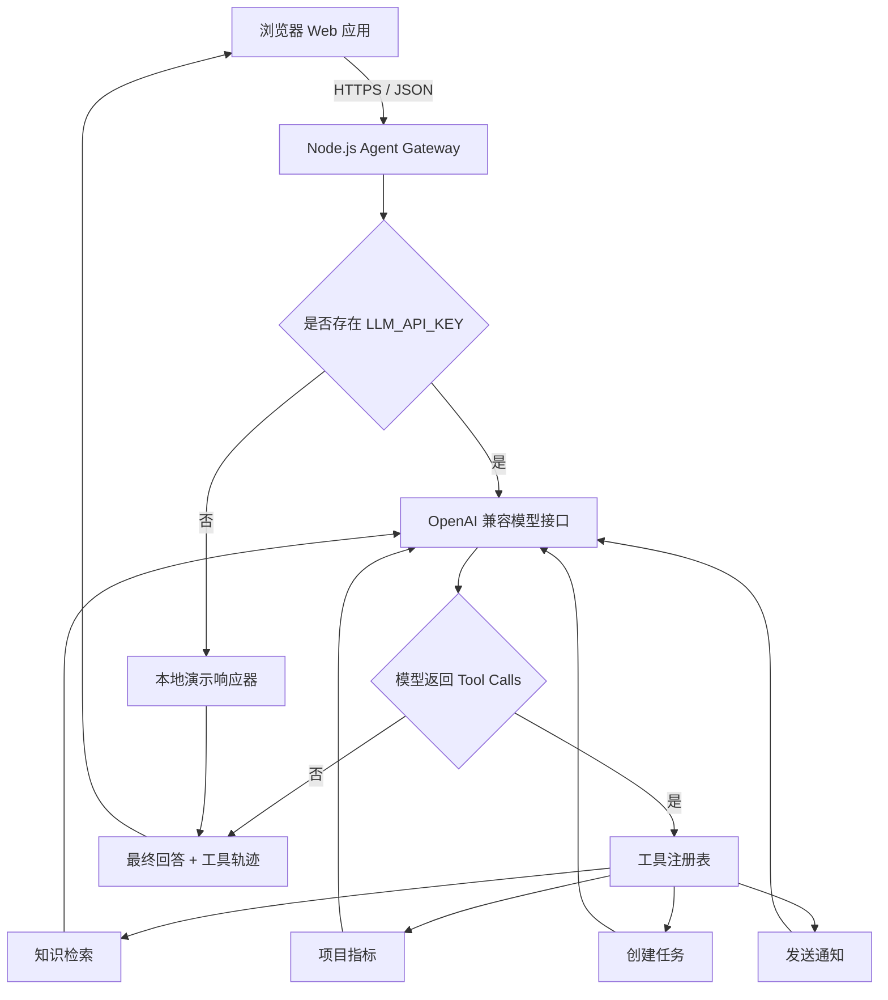

# NEXA Agent Workspace 技术方案

## 一、技术目标

技术方案需要同时满足比赛演示稳定性、Agent 能力真实性和 Web 体验完整度：

- 支持真实大模型和原生 Tool Calling。
- 不依赖第三方前端框架或构建工具，降低现场启动风险。
- 模型不可用时自动降级到本地演示模式。
- 前端能够展示规划、工具、来源、运行状态和执行记录。
- 桌面与移动端均可使用。

## 二、总体架构



系统分为三层：

1. **Web 体验层**：页面渲染、状态管理、交互反馈、响应式布局。
2. **Agent Gateway 层**：模型调用、工具注册、工具执行、轨迹聚合与降级策略。
3. **企业能力层**：知识库、指标数据、任务系统与协作通知。

## 三、前端实现

### 3.1 技术选择

前端使用原生 HTML、CSS 与 ES6 JavaScript，原因如下：

- 无需安装依赖和构建，启动命令即可运行。
- 避免比赛现场因网络或包管理问题导致无法启动。
- 页面结构、样式和交互完全可控，便于进行高完成度视觉实现。
- Node 服务端仍然可以提供真实大模型能力，不以“纯静态演示”代替 Agent 逻辑。

### 3.2 状态管理

`assets/app.js` 维护单页应用状态，包括：

```text
当前页面
会话列表与活动会话
生成状态与生成令牌
知识文档与检索条件
工具连接与启用状态
工作流节点、缩放、选中节点与运行日志
任务看板与筛选状态
运行记录与展开项
```

页面切换采用模板渲染，统一由 `renderView()` 写入主内容区域。状态更新后重新渲染当前视图，保持实现轻量且可预测。

### 3.3 交互可观测性

- 生成任务使用令牌控制，停止后旧异步结果不会覆盖新状态。
- 工作流运行按节点推进状态并写入日志。
- 工具调用结果以独立轨迹组件展示。
- 写操作与人工审核状态采用显式标签。
- 所有主要交互均有 Toast 或状态反馈。

### 3.4 响应式设计

- `<= 1280px`：压缩侧栏与内容间距，降低列密度。
- `<= 1120px`：隐藏对话上下文栏，工作流检查器改为覆盖层。
- `<= 960px`：侧栏变为抽屉，主内容切换为单栏。
- `<= 760px`：任务看板横向滚动，对话侧栏收起。
- `<= 480px`：指标与操作按钮重排，保证长文本不溢出。

## 四、Agent Gateway 实现

### 4.1 接口

#### 健康检查

```http
GET /api/health
```

返回当前运行模式、模型名称、已注册工具和更新时间。

#### Agent 运行

```http
POST /api/agent/run
Content-Type: application/json
```

请求：

```json
{
  "messages": [
    { "role": "user", "content": "生成本周产品运营周报" }
  ]
}
```

响应：

```json
{
  "ok": true,
  "mode": "llm",
  "content": "周报正文",
  "plan": ["理解目标", "读取项目指标", "企业知识检索", "生成交付物"],
  "toolTrace": [
    {
      "name": "get_project_metrics",
      "label": "读取项目指标",
      "detail": "获取活跃、激活与留存数据",
      "status": "done"
    }
  ],
  "sources": []
}
```

### 4.2 Agent 循环

```text
接收多轮消息
  ↓
注入系统提示词和工具定义
  ↓
调用大模型
  ↓
模型是否返回 tool_calls？
  ├─ 否：返回最终内容与轨迹
  └─ 是：执行工具，将结果写回上下文，最多循环 4 轮
```

限制四轮工具调用可以避免无限循环和不可控 Token 消耗。工具调用异常会作为结构化结果回传模型，保证模型能够解释失败并给出降级方案。

### 4.3 系统提示词

系统提示词强调：

- 先理解目标、约束和交付物。
- 涉及内部事实时优先调用工具，不编造。
- 工具失败时明确影响与替代方案。
- 最终回答优先输出结论、数据、风险和下一步。
- 不展示隐藏思维过程。
- 只在用户明确要求时执行写操作。

完整提示词见 [`05-Agent提示词与工具定义.md`](05-Agent提示词与工具定义.md)。

## 五、工具定义与执行

| 工具 | 参数 | 返回值 | 安全边界 |
| --- | --- | --- | --- |
| `search_knowledge` | `query`, `limit` | 标题、类型、内容、命中数量 | 只读 |
| `get_project_metrics` | `scope` | 活跃团队、激活率、留存、渠道 | 只读 |
| `create_follow_up` | `title`, `owner`, `due` | 任务 ID、状态 | 写操作，需明确指令 |
| `send_notification` | `channel`, `summary` | 消息 ID、发送渠道 | 写操作，需明确指令 |

工具使用 JSON Schema 定义，与 OpenAI Tool Calling 格式兼容。每个工具的结果都会生成面向用户的可读轨迹，不完全暴露原始参数。

## 六、知识与数据设计

当前版本使用内置演示知识库和运营指标，接口返回结构与企业真实系统保持一致，便于后续替换：

- 知识库：文档 ID、标题、类型、更新时间、内容分块。
- 指标系统：产品范围、增长范围、周期与指标值。
- 任务系统：任务 ID、负责人、截止时间、状态。
- 通知系统：渠道、消息 ID、发送状态。

后续可替换为向量数据库、数据仓库 API、飞书开放平台和企业内部任务系统。

## 七、安全设计

1. **密钥隔离**：`LLM_API_KEY` 仅存在服务端环境变量，前端无法读取。
2. **输入边界**：消息仅接受 `user` 与 `assistant` 角色，单条内容限制 12,000 字符，请求体限制 1 MB。
3. **工具白名单**：模型只能调用注册表中的四个工具。
4. **循环上限**：单次请求最多四轮工具调用。
5. **超时控制**：模型请求 35 秒超时。
6. **写操作约束**：提示词明确要求写操作需用户明确指令，产品中设置人工审核节点。
7. **静态目录保护**：服务端解析静态路径并校验项目根目录，避免路径穿越。

## 八、稳定性与降级

- 没有配置 Key 时，服务端直接使用本地响应器。
- 模型接口异常时，服务端返回演示响应并标记 `demo-fallback`，保证现场演示继续。
- 前端无法访问 API 时，也会使用本地响应器生成回答。
- 演示模式保留规划、工具轨迹、知识来源和结果结构，不影响产品叙事。

## 九、测试方案

### 9.1 语法检查

```bash
npm run check
```

覆盖 `server.mjs`、`assets/app.js` 和 `assets/icons.js`。

### 9.2 浏览器视觉与交互验收

```bash
python tests/visual_check.py
```

测试内容：

- 工作台首屏加载。
- 智能对话发送与结果生成。
- 工作流运行与完成状态。
- 任务中心渲染。
- 知识库页面和详情。
- 工具连接开关。
- 运行记录展开。
- 390 × 844 移动端布局与抽屉导航。
- 浏览器控制台错误与页面横向溢出检查。

## 十、可扩展方向

- 接入真实向量数据库与文档解析服务。
- 使用 WebSocket 或 SSE 实现逐 Token 流式输出。
- 增加工作流版本管理、发布审批和回滚。
- 将工具连接升级为 OAuth 授权和细粒度 RBAC。
- 增加多 Agent 协作、角色路由与任务交接。
- 使用数据库持久化会话、运行记录和用户配置。
- 接入企业级日志、审计和成本分析。
